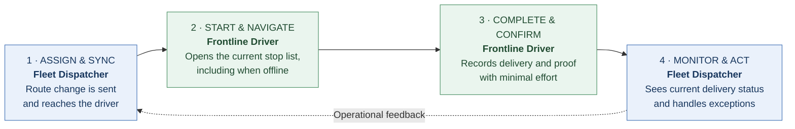

# RouteLogic — Future-State Customer Journey

**Strategic ambition:** Reclaim operational simplicity by making RouteLogic the fastest, most reliable way for drivers and dispatchers to manage everyday fleet operations.

**Value proposition:** For frontline fleet coordinators, deliver a faster, simpler operational experience that makes daily fleet activities effortless—protecting customer retention and RouteLogic’s market position.

## Future-state journey

The journey follows the operational flow from dispatch to delivery and back to dispatch visibility. The two personas alternate as work moves between the field and the control desk.

## The four stages

### 1. Assign & synchronise
**Persona:** Fleet Dispatcher

- **User Action:** Reassign route → Driver receives the updated instructions promptly.
- **Internal State:** Confident that drivers are working from the current plan.
- **Pain Point Addressed:** 8–15-minute route-update delays and WhatsApp coordination.

### 2. Start & navigate
**Persona:** Frontline Driver

- **User Action:** Open route → Access the stop list, including when connectivity drops.
- **Internal State:** Prepared and confident the route remains available throughout the shift.
- **Pain Point Addressed:** Missing offline stop lists, route loss after crashes and paper backups.

### 3. Complete & confirm
**Persona:** Frontline Driver

- **User Action:** Complete stop → Record delivery and proof with minimal steps.
- **Internal State:** Uninterrupted and confident the delivery record has been saved.
- **Pain Point Addressed:** Three-screen completion, failed photo uploads and manual workarounds.

### 4. Monitor & act
**Persona:** Fleet Dispatcher

- **User Action:** View delivery status → Identify exceptions and respond using current information.
- **Internal State:** In control and able to trust the operational dashboard.
- **Pain Point Addressed:** 20–60-minute status delays and manual driver verification.

## Three competitive advantages over manual workarounds

1. **One connected operational record:** Route changes, delivery outcomes and proof of delivery stay together, reducing duplicated communication.
2. **Reliable access in the field:** Drivers can access route information when connectivity is unavailable, reducing dependence on screenshots and paper manifests.
3. **Timely operational visibility:** Dispatchers can monitor delivery progress in RouteLogic instead of chasing updates through WhatsApp and phone calls.

## Strategic outcome

- **For drivers:** Less administration, fewer interruptions and faster delivery completion.
- **For dispatchers:** More reliable coordination, current information and greater operational control.
- **For the business:** Stronger frontline adoption, greater enterprise value realisation and reduced customer retention risk.

**Success means RouteLogic becomes the easiest and most dependable way to complete and coordinate daily delivery work—so users no longer need a parallel operating system.**
